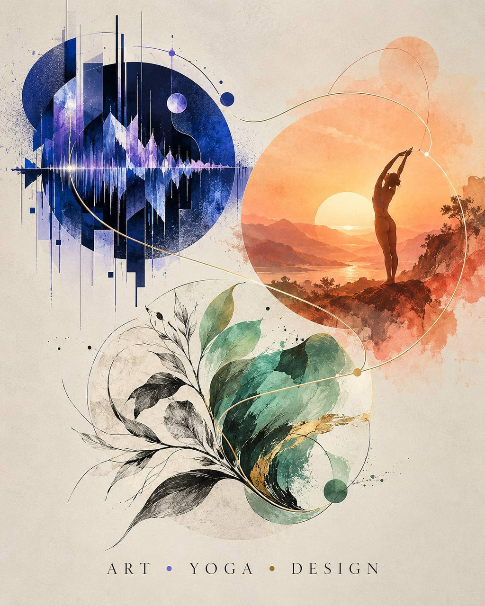

# Art → Yoga → Design

Три направления открытого портфолио Снежаны. **Начинаем с Art.** Обложка предоставлена Снежаной; исходные работы проектов остаются в своих репозиториях.

## 01 · Art — текущий этап

[ArtRave / Sound Atlas](https://github.com/yogasnow/art-rave-atlas-sound) — опубликованные материалы об искусстве и звуке. [Порядок работы с разделом Art](art/README.md).

[Картины Снежаны](art/paintings/README.md) — первая подборка: три работы на пяти фотографиях.

## Далее

- **Yoga:** существующие [Astro-Yoga](https://github.com/yogasnow/astro-yoga) карточки; здесь раздел пока не собран.
- **Design:** визуальные системы и учебные карточки; состав этого раздела ещё не отобран.

[Происхождение обложки](PROVENANCE.md). Отдельная лицензия на её повторное использование не заявлена.
