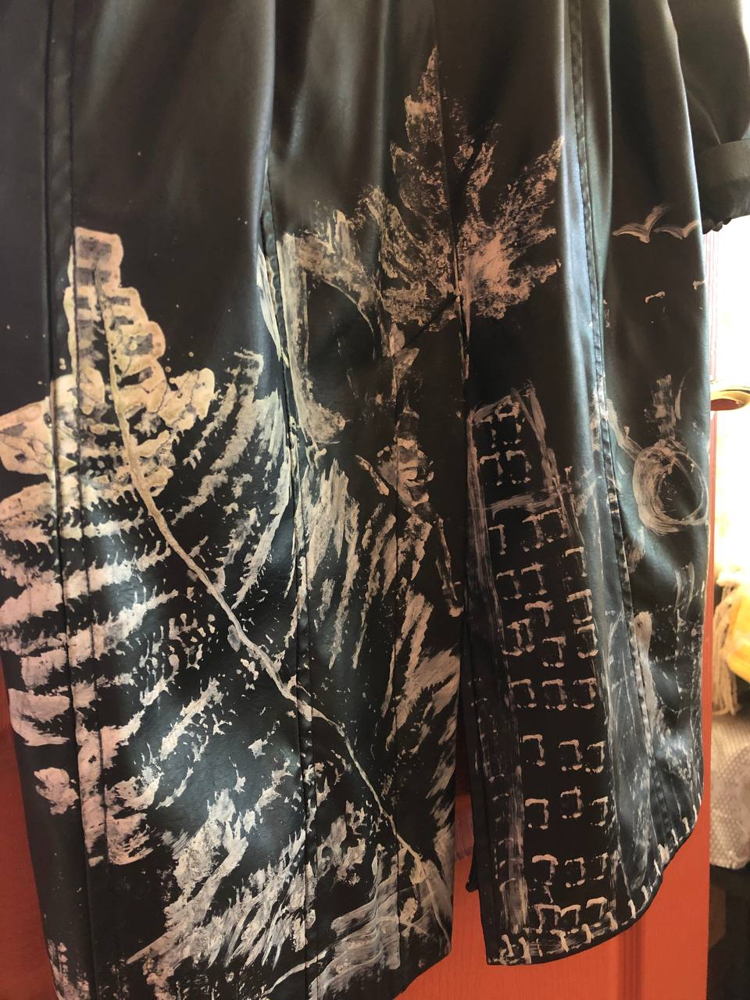
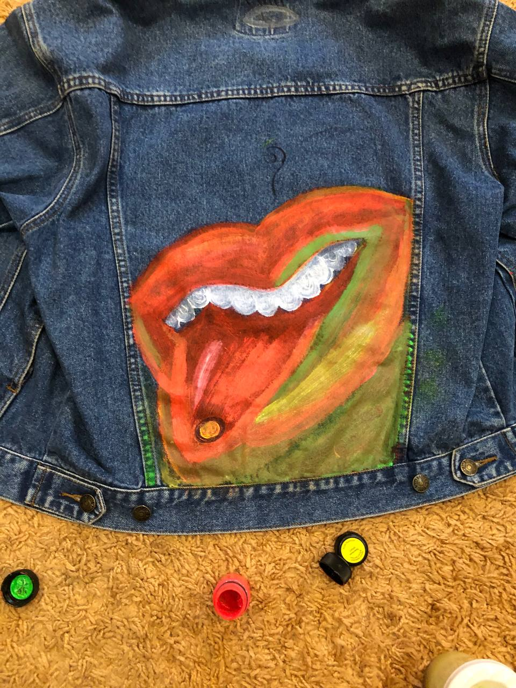
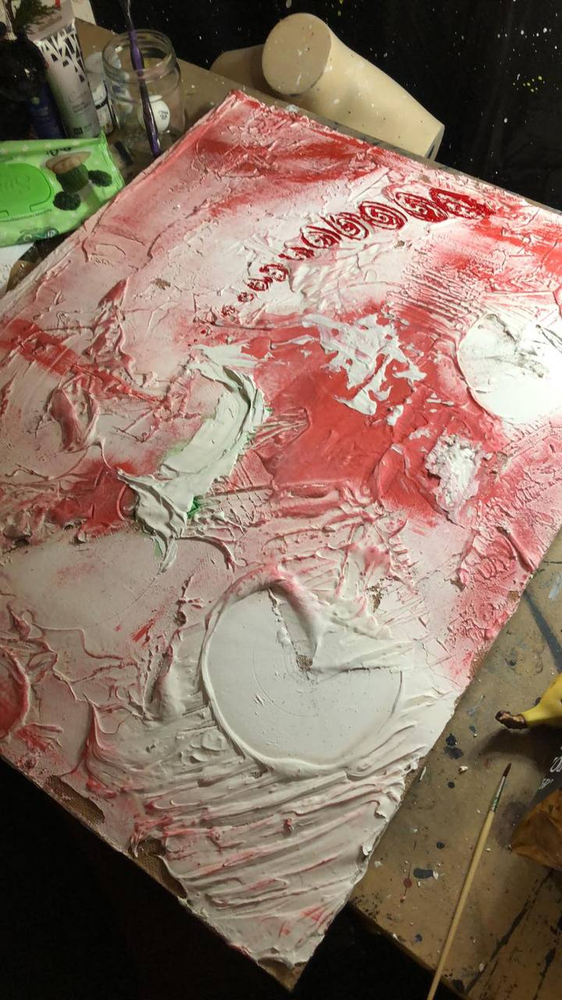

# Картины Снежаны

Авторская галерея внутри раздела **Art**. Первая подборка — три работы на пяти фотографиях, присланных Снежаной 27 октября 2026 года. Подписи здесь описательные, не авторские названия. Обложка всего проекта не считается отдельной картиной.

## Работы

### 01 · Роспись на тёмной одежде

[Деталь росписи](works/01-dark-garment/detail-paint.jpg) · [Деталь знаков](works/01-dark-garment/detail-marks.jpg)

Три ракурса одной работы, не три отдельные картины.

### 02 · Роспись на джинсовке

### 03 · Фактурная работа на холсте

Фото показывает рабочий процесс; окончательное состояние работы не подтверждено.

Поля для авторских названий, дат, материалов и размеров оставлены в [каталоге](CATALOG.md) без догадок.

## Как добавляем работу

1. Сверяем изображение с авторским исходником и сохраняем выбранный файл без подмены.
2. Добавляем его в `works/` под понятным именем. Если нужна уменьшенная версия для просмотра, сохраняем её отдельно и указываем, где оригинал.
3. Вносим работу в [каталог](CATALOG.md): авторское название, год (если известен), техника/материал (если известны), статус и ссылку на файл. Неизвестное оставляем пустым, не придумываем.
4. Варианты и этапы одной картины связываем с ней, а не считаем новыми работами.

Картины и их изображения не получают автоматически открытую лицензию на повторное использование. Условия можно указать для каждой работы после решения автора.
