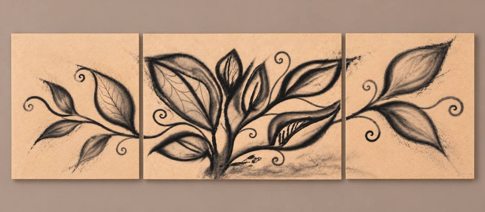
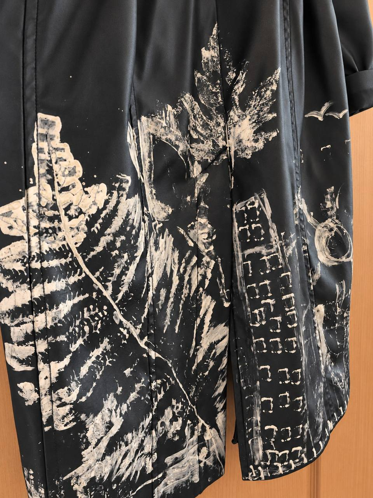
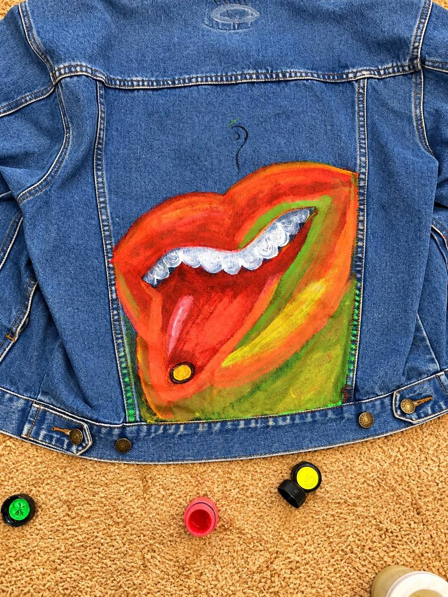
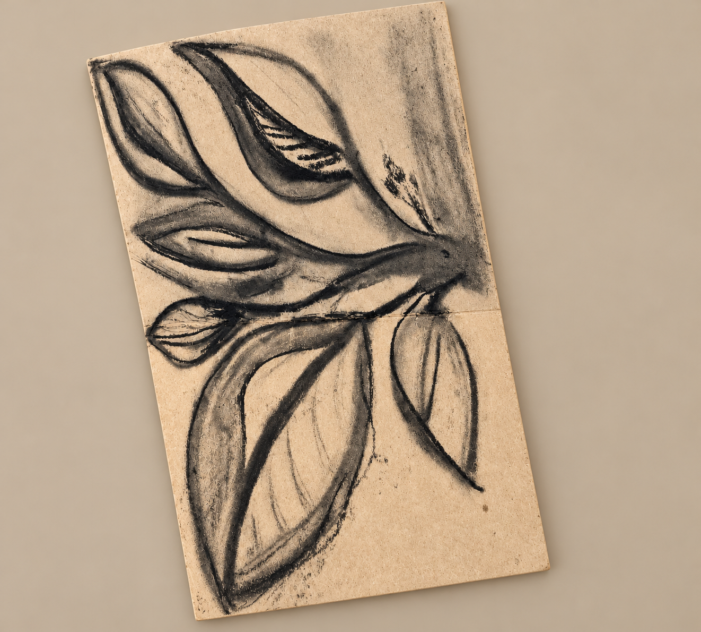
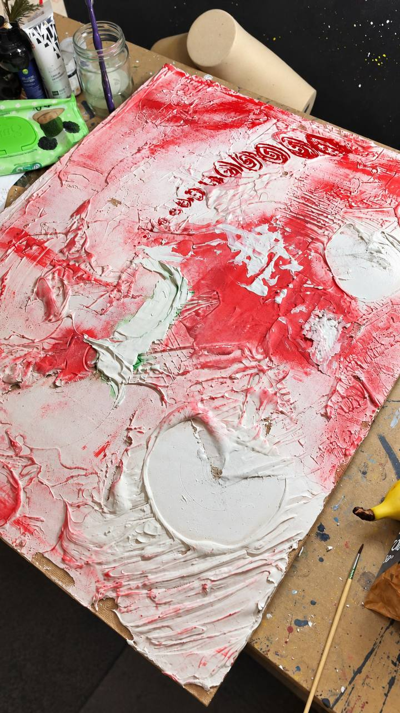

# Tactical Urbanism

Первая подборка Снежаны в разделе **Art**. Четыре исходные работы представлены семью изображениями, включая заглавную композицию. Описательные подписи ниже не заменяют авторские названия.

Этот присланный Снежаной триптих — заглавное изображение раздела Art. Он не обозначен как документальная фотография исходного рисунка и не увеличивает число исходных работ.

## 01 · Роспись на тёмной одежде

[Деталь композиции](images/01-dark-garment-detail.jpg) · [Деталь мазков](images/02-dark-garment-marks.jpg)

Три ракурса одной работы.

## 02 · Роспись на джинсовке

## 03 · Ботанический рисунок

Для этой презентационной версии фон исходной фотографии заменён: записи в блокноте не публикуются. Изображение рисунка обработано инструментом генеративного редактирования, поэтому не выдаётся за точную архивную копию оригинала.

## 04 · Фактурная работа на холсте

Снимок показывает рабочий процесс; окончательное состояние работы не подтверждено.

Фотографии 01–04 и 06 присланы Снежаной 27 октября 2026 года и заменили прежние ракурсы. Отдельная лицензия на повторное использование изображений не заявлена.
